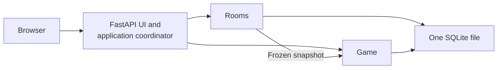
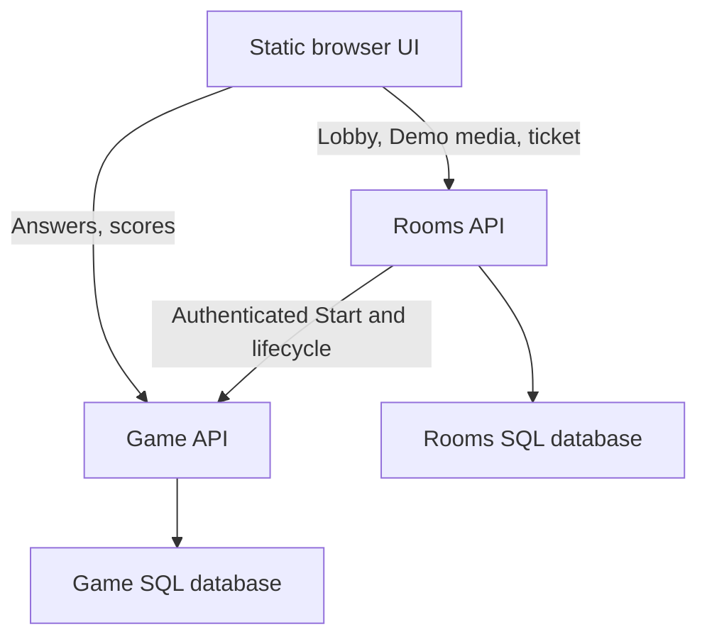
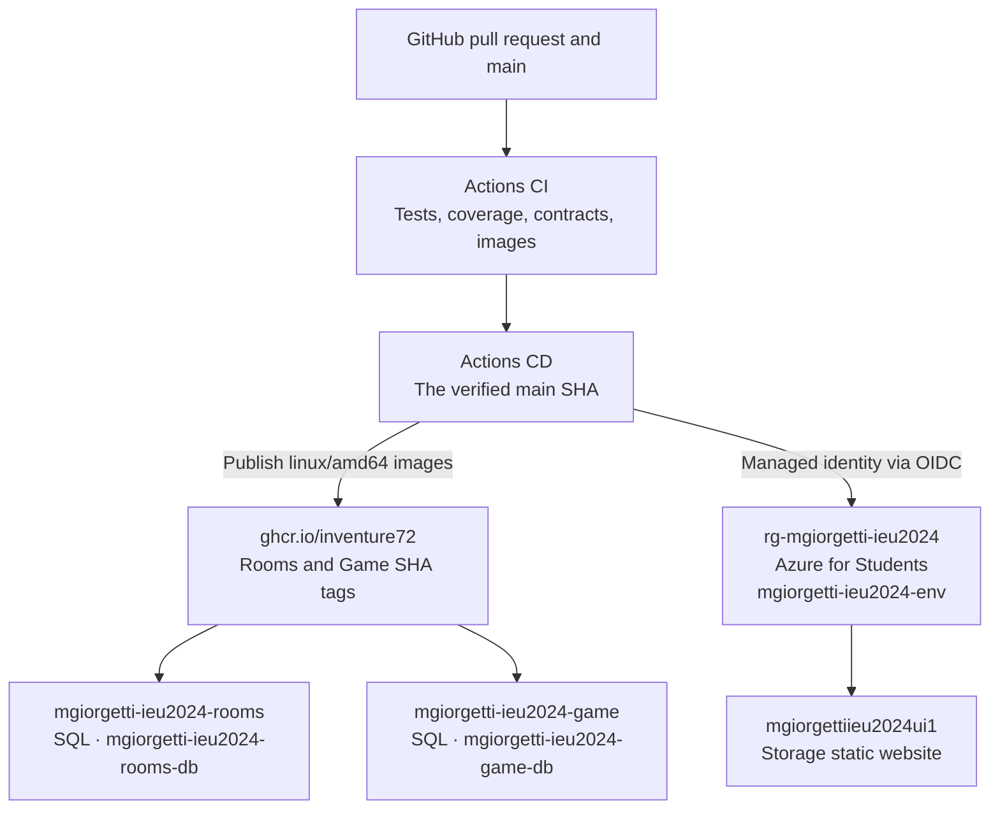
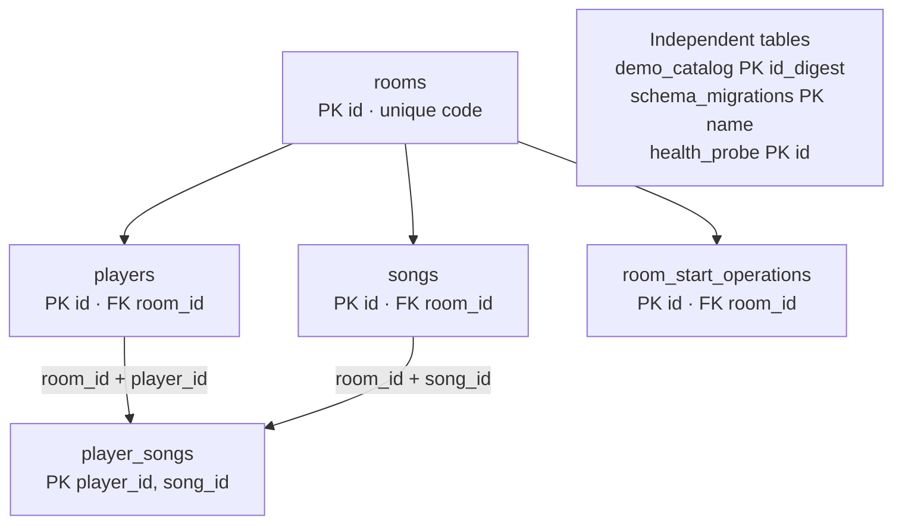
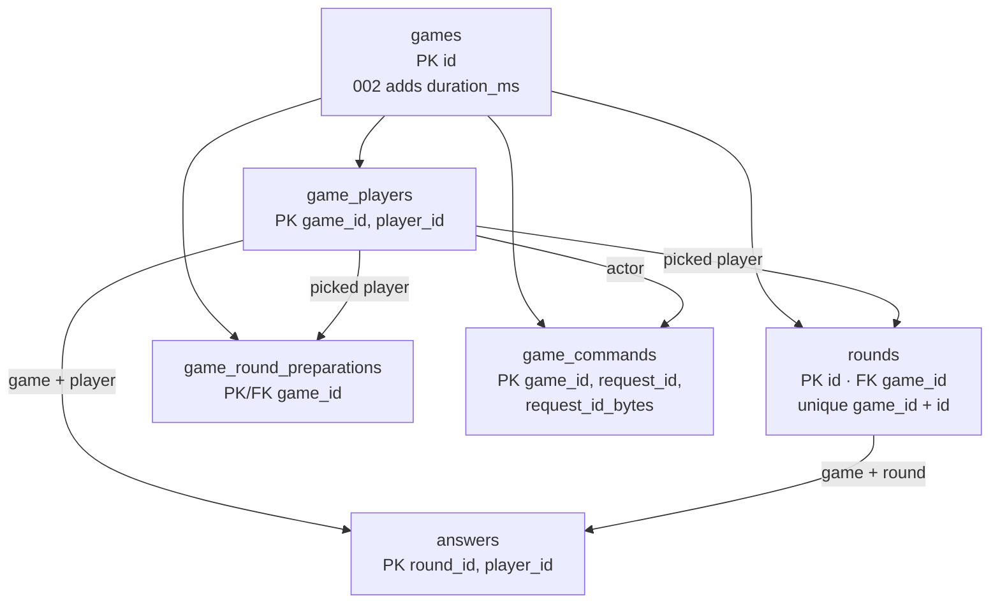

# Who's On Repeat

Matteo Giorgetti | Assignment 2 | 26 November 2026

## 1. Architecture before and after

### Assignment 1

The FastAPI monolith served the browser and both domains. At Start, the application coordinator passed a snapshot of players, settings and songs from Rooms to Game inside one SQLite transaction. Each domain owned its tables in `whos_on_repeat.sqlite3`.

### Assignment 2

The static browser UI calls both FastAPI services over HTTPS. Rooms serves lobby, invitations, Demo audio and search, and issues short-lived Game tickets. Game checks the ticket against the frozen roster and owns rounds, answers and final scores. Rooms durably saves the Start identity and snapshot before sending them to Game. A timeout leaves the room reserved so a retry can use the original identity.

Rooms calls `POST /internal/games` at Start and `POST /internal/rooms/{room_id}/game-lifecycle` for presence and terminal reconciliation. Game never queries Rooms tables. The two databases use independent SQL users. [Service boundary](20_SERVICE_SPLIT.md)

## 2. Deployment and pipeline

Rooms and Game use the `mgiorgetti-ieu2024-env` Container Apps environment at zero to one replica each. One logical server, `mgiorgetti-ieu2024-sql`, hosts `mgiorgetti-ieu2024-rooms-db` and `mgiorgetti-ieu2024-game-db` under the serverless free offer. The `mgiorgetti-ieu2024-logs` workspace stores runtime logs. Azure Storage serves the page and publishes only the two HTTPS API origins in browser configuration.

CI checks both core coverage gates, the committed OpenAPI and system manifest, two container builds and disposable SQL Server integration. CD publishes the tested commit, verifies each API's own database and SHA, and then uploads the UI. [Live Demo](https://mgiorgettiieu2024ui1.z28.web.core.windows.net/) · [Azure setup and runbook](22_AZURE_DEPLOYMENT.md)

The first deployment failed while enabling the static website. Reproducing the CLI call returned `NoAuthenticationInformation`. The fix retrieves the exact storage account's key with group-scoped access and passes it only to the storage subprocess. A later SQL failure traced to FreeTDS 1.5.19 rejecting the Azure certificate. The builds now use 1.5.22 with certificate and hostname verification active. [Storage failure](https://github.com/Inventure72/DevOpsAssignement/actions/runs/45037213177) · [SQL failure](https://github.com/Inventure72/DevOpsAssignement/actions/runs/45039047218) · [Successful baseline CD](https://github.com/Inventure72/DevOpsAssignement/actions/runs/45040219985) · [Successful migration CD](https://github.com/Inventure72/DevOpsAssignement/actions/runs/45845296464)

## 3. Rooms database

Rooms owns live membership, song associations, the bundled catalog and the record of each Start operation. Both sides of the `player_songs` association carry the room key, so a row cannot connect a player in one room to a song in another.

The foreign keys in `player_songs` point to the unique pairs `(room_id, id)` in `players` and `songs`. Rooms enforces one host and unique nickname keys within a room. Song identity is unique per room.

The Start row stores the request digest, frozen payload, optional Game ID and reconciliation timestamp. A retry uses the persisted operation identity and snapshot. The Game ID is an application reference across the service boundary. [Rooms migration files](../services/rooms/migrations/)

Membership and library changes update the room revision. Start records the snapshot at that revision, then reserves the lobby until Rooms knows the outcome. This lets Rooms continue serving lobby reads while Game is unavailable.

## 4. Game database

Game stores the Start snapshot, match state, ready players, round outcomes and receipts. Game-player IDs come from the frozen roster. Match records point to the Room ID by value, with integrity enforced within each service's database.

`game_round_preparations` stores the next candidate and readiness generation. `game_commands` keeps the accepted request and response so a caller can retry safely. Answers reference both the round and the frozen player using composite foreign keys with `game_id`.

Game also owns `health_probe` with primary key `id` and `schema_migrations` with primary key `name`. On startup the runner checks applied checksums. It commits each new migration together with its receipt. [Game migration files](../services/game/migrations/)

## 5. Runtime evidence

### Azure migration and repeat startup

The November 22 Azure baseline ran a five-round Demo in three browser sessions and accepted all 15 answers. Match `9aa831004afc4b42885ffbe84a7a596f` finished with scores of 325, 200 and 175. The host browser rendered five non-silent clips through its Web Audio graph. Physical speaker output was outside that check.

On November 26, the pre-deploy SQL read found the saved match and only migration `001`. The [migration deployment](https://github.com/Inventure72/DevOpsAssignement/actions/runs/45845296464) published `5d632b4d59f991d6f5f51149a94df26778203f78`. The new Game replica logged `Applied Game migration 002_game_duration.sql` at 15:08:47 UTC. Read-only queries used Game's scoped SQL user. The original `001` checksum and applied time matched.

| Saved match | Before 002 | After 002 |
| --- | --- | --- |
| Revealed rounds | 5 | Same 5 rows |
| Submitted answers | 15 | Same 15 rows |
| Scores in rank order | 325, 200, 175 | 325, 200, 175 |
| Persisted duration | Column absent | 123,220 ms |

With zero active games, Game was stopped and started through Azure. A different replica completed startup at 15:11:43 UTC and returned healthy at the same SHA. Its startup logged zero migration applications. The second read returned identical match rows and both migration receipts, including their applied timestamps.

### Partial failure

In clean-clone Compose testing on November 19, stopping Game left Rooms health and lobby reads at HTTP 200. Start returned HTTP 503 with `game_start_pending` (234 ms), and retry after recovery returned the same Game ID. With Rooms stopped, Game state and host audio remained available under an existing ticket. New tickets became available again after recovery. These peer-outage checks ran locally. [Outage evidence](20_SERVICE_SPLIT.md#clean-clone-acceptance--2026-11-19)

### AI disclosure draft

For author review. Generative AI assisted with planning, code and tests, infrastructure and CI/CD, troubleshooting, and drafting this report. The project AI usage log records the accepted contributions and explanations. The author will review the disclosure and the log before submitting.
